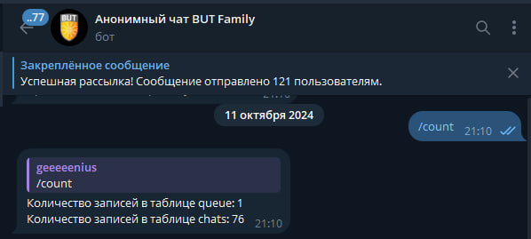

# BUT Anonymous Chat

A Telegram bot that pairs university students into anonymous one-to-one conversations.

Built in 2024 for the student body at Bucheon University in Tashkent. It reached **300+ active
users and 76 simultaneous chats within the first month**, entirely on word of mouth, with zero
marketing spend — before being shut down administratively.



---

## What it does

A student sends `/search`, gets dropped into a queue, and is matched with another waiting student.
Neither side sees who the other is. Messages, photos and videos are relayed between the two until
one of them sends `/stop`.

The matching is gender-aware: users declare a gender on first run, and the queue can pair by
preference rather than purely first-come-first-served.

## Features

**For students**

| Command | What it does |
|---|---|
| `/start` | Register and set your gender |
| `/search` | Join the queue and get matched |
| `/stop` | Leave the current chat or the queue |
| `/menu` | Show the keyboard menu |
| `/donate` | Support the project |

Photos and videos are relayed between partners, not just text.

**For admins**

| Command | What it does |
|---|---|
| `/count` | Live counters: users, queue length, active chats |
| `/sendall` | Broadcast a message to every registered user |
| `/banuser` | Ban a user by id |
| `/showuserid`, `/showusername` | Look up a user |
| `/maxuserid` | Highest registered id |
| `/searchall` | List all users |

## How it works

```
Telegram  ──►  bot.py            long-polling handlers, message relay
                 │
                 ├── config.py    env-based configuration
                 │
                 └── database.py  SQLite access layer
                        │
                        ├── users   chat_id, gender, username, ban
                        ├── queue   who is currently waiting
                        └── chats   active pairs (chat_one ↔ chat_two)
```

Three tables is the whole model. `queue` holds everyone waiting, `chats` holds the live pairings,
and a match is just a row moving from one to the other. Keeping the state that small is why a
single-file bot could hold 76 concurrent conversations without trouble.

## Running it

```bash
git clone https://github.com/starboyqwerty/but-anonymous-chat
cd but-anonymous-chat

python -m venv venv
source venv/bin/activate        # Windows: venv\Scripts\activate
pip install -r requirements.txt

cp .env.example .env            # then put your token in it
python bot.py
```

Get a bot token from [@BotFather](https://t.me/BotFather) and put it in `.env`:

```
BOT_TOKEN=123456:ABC-your-token-here
ADMIN_IDS=your_telegram_user_id
```

The SQLite file is created automatically on first run.

## A note on data

The original production database is **not** in this repository and never will be. It held real
Telegram user ids and usernames from students who used the bot expecting anonymity. `*.db` is in
`.gitignore` for that reason — if you fork this, keep it that way.

## What I learned

The bot spread without a single post promoting it, which taught me more about distribution than
anything I built deliberately afterwards. Anonymity was the whole product: the moment you strip it
out, the reason to open the bot disappears. Everything else — gender matching, media relay, admin
tooling — was secondary to protecting that one property.

## License

MIT — see [LICENSE](LICENSE).

---

Built by [Amar Farkhadi](https://amar-farkhadi.vercel.app/)
